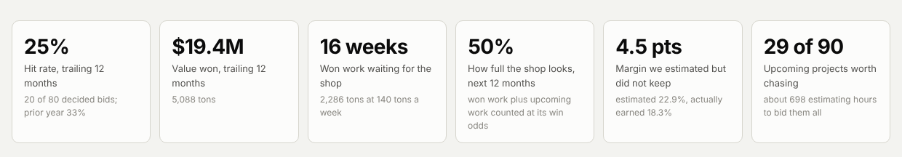
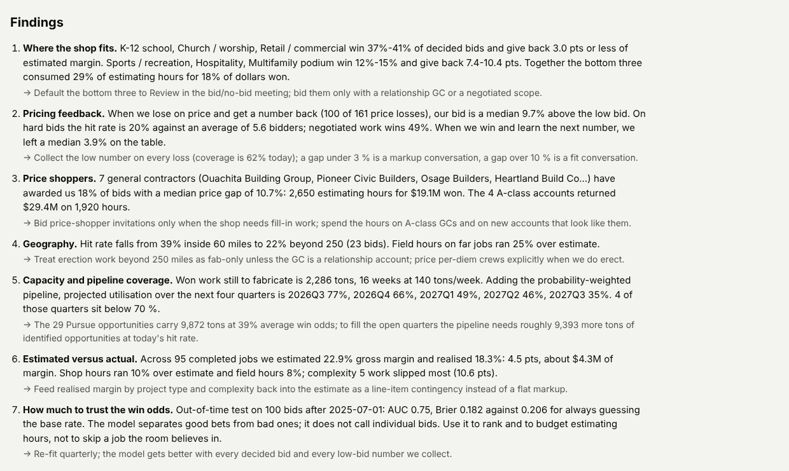
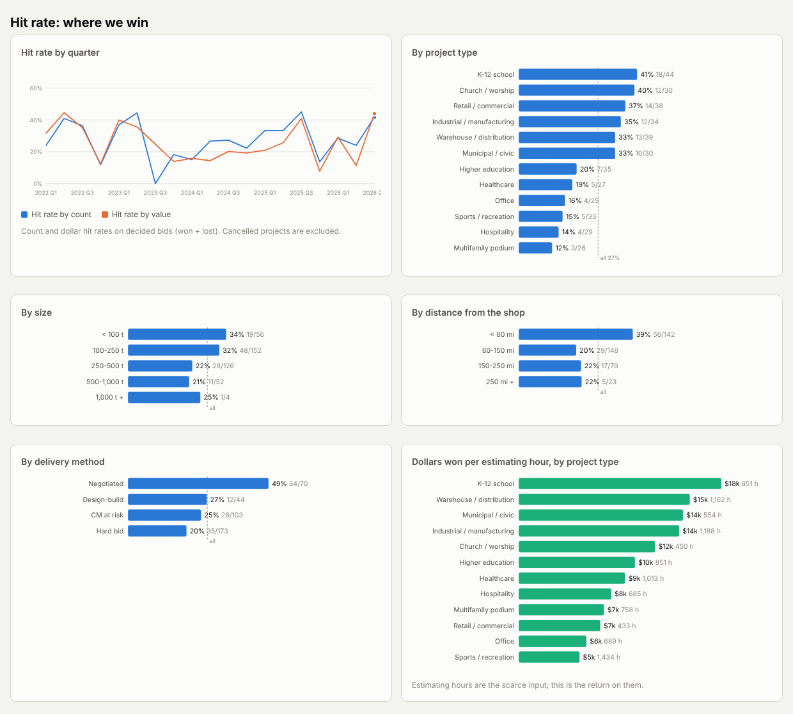
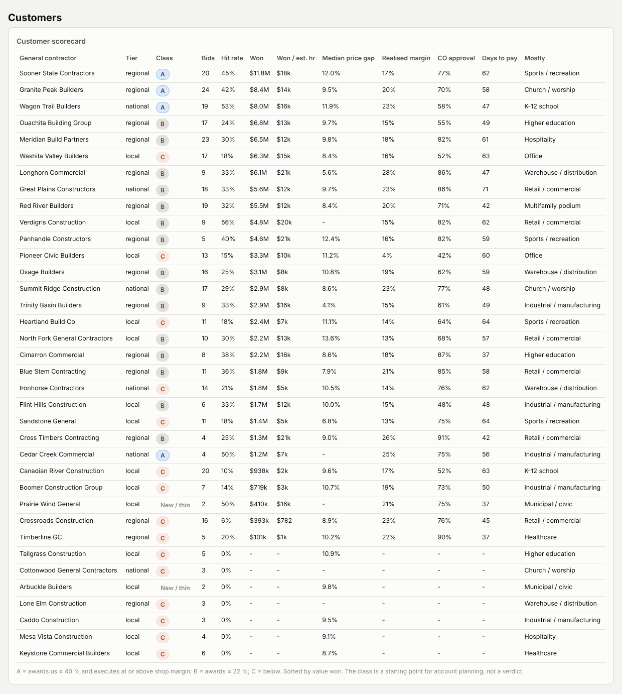
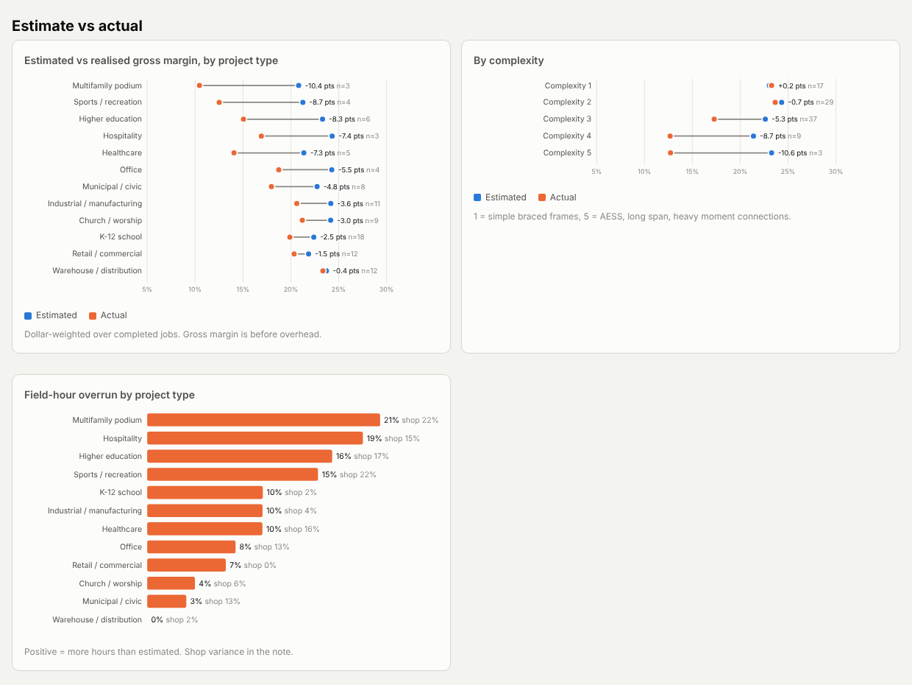
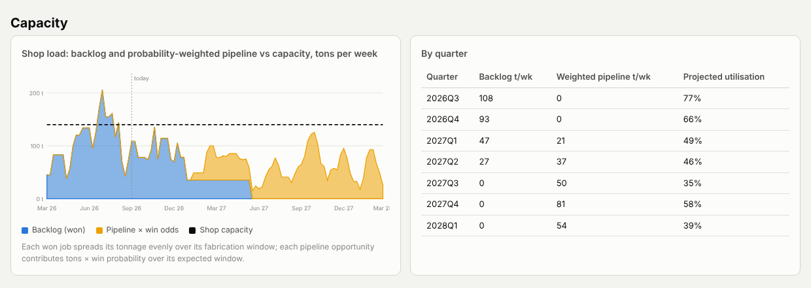
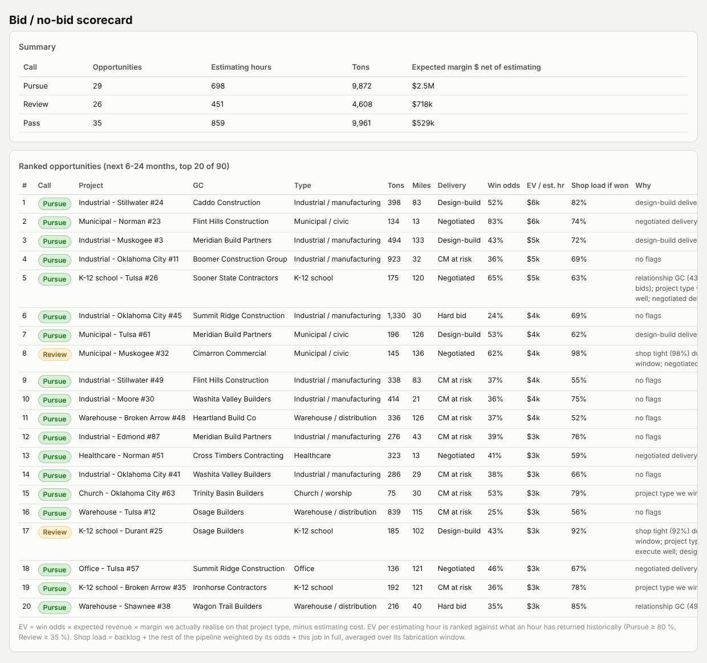
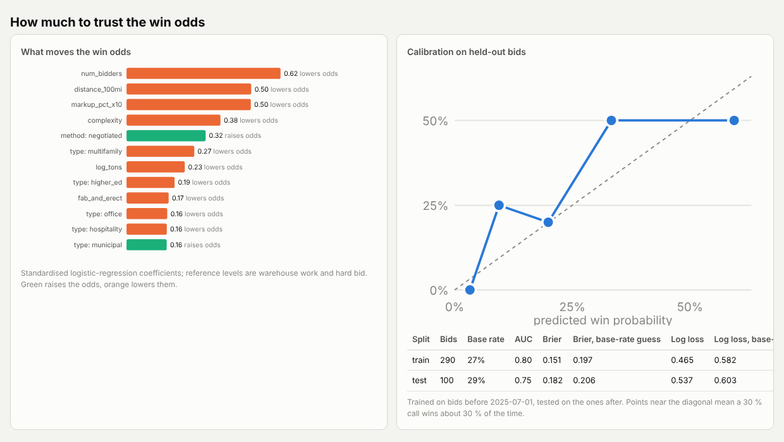

# Weibee Steel · Bid Intelligence

**Where we win, what the work actually earns, and which of the next two years' projects deserve our estimating hours.**

A work sample built for Weibee Steel's Business Development Associate role. It takes a steel
fabricator's bid history and turns it into a one-page report plus a ranked list of upcoming projects
with a **Pursue / Review / Pass** call on each.

> **Start here:** [the report as a PDF](docs/bid_intelligence_report.pdf) · [the executive deck](docs/Weibee_Bid_Intelligence_Executive_Overview.pptx) ([PDF](docs/Weibee_Bid_Intelligence_Executive_Overview.pdf)) · [how to demo it on a call](docs/DEMO_GUIDE.md) · or read the summary below.
> Everything in it is built on **made-up (synthetic) data** that behaves like a real shop's history. Nothing is Weibee Steel's data.

---

## The idea in one minute

Every fabricator already knows, roughly, "we do well on schools" or "we never get the hospital work."
This project turns that gut feel into numbers with denominators:

- **How often we win**, by kind of project, size, distance, customer and how the job is bought.
- **What the work actually earned** once it was built, compared with what the estimate promised.
- **How far off our price was** when we lost on price.
- **Who awards us work** and who just uses us to check their numbers.
- **Whether the shop can take what we are chasing**, week by week.

Then it puts all of that behind one question an estimating manager asks every Monday:
*"Is this invitation worth a week of an estimator's time?"*

## What the report shows

### 1. The business at a glance



Six numbers: how often we win, what we won, how much won work is waiting for the shop, how full the
shop looks once upcoming work is counted at its odds, how much margin the estimates promised but the
jobs did not keep, and how many of the upcoming projects are worth chasing.

### 2. Findings, in plain words, each with a next action



These are written by the pipeline from the numbers, not typed in, so they stay true when the data changes.
On the sample run:

| Finding | What it means for the bid meeting |
|---|---|
| K-12, church and retail work wins 37-41 % of bids and keeps its margin. Sports, hospitality and podium work wins 12-15 % and gives back 7-10 points of margin, while eating 29 % of estimating hours for 18 % of dollars won. | Default the bottom three to "Review". Bid them with a relationship GC or a negotiated scope, not on a hard bid. |
| When we lose on price we are a median 9.7 % high. Negotiated work wins 49 %; hard bids win 20 % against 5-6 bidders. | A gap under 3 % is a markup conversation. A gap over 10 % means we should not have been there. |
| Seven GCs award us 18 % of bids at an 11 % price gap: 2,650 estimating hours for $19M won. Four A-class accounts returned $29M on 1,900 hours. | Spend the hours on the A-class accounts and on new GCs that look like them. |
| Won work covers the shop for 16 weeks. After Q1 2027 the shop is less than half full unless the pipeline converts. | We need roughly 9,000 more tons of identified opportunities at today's hit rate. |
| Estimates promised 22.9 % gross margin; jobs delivered 18.3 %. Complex work slips most. | Put realised margin by project type back into the estimate as a line item, not a flat markup. |

### 3. Where we win



Hit rate by project type, size, distance from the shop and how the job is bought, plus the
dollars won per estimating hour, which is the return on the estimating team's time.

### 4. Which customers are worth the hours



One row per general contractor: how often they award us, what it was worth, how far off we were on
price, what margin their jobs actually earned, how they behave on change orders and how fast they pay.
A first-cut A / B / C class for account planning.

### 5. What the estimate promised versus what the job earned



Blue dot is the estimate, orange is what happened. The gap is the money that was in the bid and not in the bank.

### 6. Can the shop take it?



Blue is won work spread over its fabrication weeks. Amber is upcoming work counted at its win odds.
The dashed line is what the shop can fabricate in a week.

### 7. The bid / no-bid scorecard



Every upcoming project in the next 6-24 months, ranked. For each one:

- **Win odds**, from our own history with that kind of job and that customer.
- **Expected value**: odds × revenue × the margin we *actually* keep on that kind of work, minus the cost of estimating it.
- **Shop load if we win it**, over the weeks it would be in the shop.
- **A call** and the reasons in plain words. *Pursue* means worth the hours with no concerns. *Review* means something is tight and the room should talk about it. *Pass* means the odds, the shop or the math say no.

The call is a starting point for the weekly bid meeting, not a verdict. The room overrides it, and the
override is logged so the next version learns from it.

### 8. How much to trust the odds



The win odds come from a small statistical model fitted to our own bids, then tested on bids it had
never seen. It is good enough to rank projects and budget estimating hours. It is not good enough to
overrule the room on a single job, and the report says so.

## Why this matters for the role

The posting asks for someone to build a GC and opportunity database, track bid results and pricing
feedback, work out why projects are won or lost, develop a bid/no-bid process, and connect estimating,
the shop, the field and leadership with data. This is a working version of that loop, end to end, on
data that behaves like a real shop's. The first 90 days on the real data are sketched in
[docs/memo.md](docs/memo.md), and the fields the intake would need to capture are in
[docs/data_dictionary.md](docs/data_dictionary.md).

## Presenting it

- **Executive deck**, 12 slides with speaker notes, for a live 15-minute walkthrough: [docs/Weibee_Bid_Intelligence_Executive_Overview.pptx](docs/Weibee_Bid_Intelligence_Executive_Overview.pptx)
- **Demo guide** with a timed script, a 5-minute version, likely questions with short answers, and what to do if screen share fails: [docs/DEMO_GUIDE.md](docs/DEMO_GUIDE.md)

## For the technical reader

The pipeline is Python and DuckDB, about 1,500 lines, runs in a second and has 23 tests.
[docs/HOW_IT_WORKS.md](docs/HOW_IT_WORKS.md) covers the marts, the model, the expected-value
arithmetic and how to run it.

```bash
make venv && . .venv/bin/activate && make run     # writes output/bid_intelligence_report.html
make test
```

## Glossary

| Term | Meaning |
|---|---|
| **Hit rate** | Share of decided bids we won. By count (3 of 10 = 30 %) or by value (dollars won ÷ dollars bid). |
| **Gross margin** | Contract price minus material, shop labour and field labour. Before overhead. |
| **Margin slip** | Estimated gross margin minus what the job really earned, in points. 5 pts on a $1M job is $50,000. |
| **Price gap** | How far above the winning number our bid was, when we lost on price and the GC told us. |
| **Estimating hours** | Time spent on the takeoff and the price. The scarce resource. |
| **Win odds** | The model's estimate of our chance of winning a bid, from what happened on similar bids. |
| **Expected value (EV)** | Win odds × revenue × realised margin, minus estimating cost. What a bid is worth before we know the outcome. |
| **Backlog** | Won work that still has to go through the shop. |
| **Weighted pipeline** | Upcoming work counted at its odds: a 400-ton job at 25 % counts as 100 tons. |
| **Shop load** | Tons scheduled in a week ÷ tons the shop can fabricate in a week. Over 100 % means overtime, outsourcing or late deliveries. |
| **Hard bid / CM at risk / negotiated / design-build** | How the project is bought: lowest price wins; the GC chooses on more than price; we price it without competition; one team designs and builds. |
